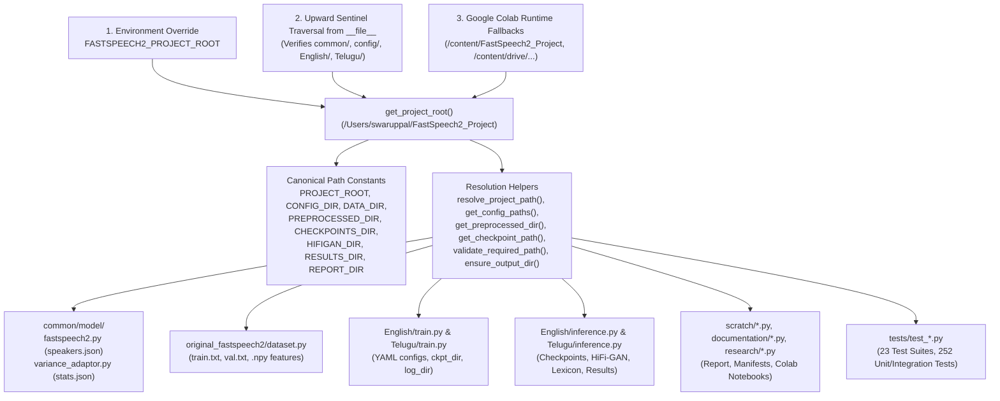

# FastSpeech 2 Project — Path Dependency & Resolution Map

**Project Root**: `/Users/swaruppal/FastSpeech2_Project`  
**Single Source of Truth**: [`common/paths.py`](../common/paths.py)  
**Date**: 2026-11-07

---

## 1. Central Path Resolution Architecture

All path resolution in the project flows through [`common/paths.py`](../common/paths.py), which sits at the bottom of the dependency DAG (importing **only** Python standard library modules `os`, `sys`, `tempfile`, `pathlib`, `typing` and **zero** PyTorch or project submodules).

---

## 2. How Each Subsystem Resolves Paths

### 2.1 Project Root Discovery (`get_project_root()`)
- **Primary Mechanism**: Walks upward from `Path(__file__).resolve().parent` (`common/paths.py`) and checks `_is_valid_project_root(candidate)`, which verifies the presence of `common/`, `config/`, `English/`, and `Telugu/`.
- **Environment Override**: Checks `os.environ.get("FASTSPEECH2_PROJECT_ROOT")` first, enabling custom deployment or container mounts.
- **Colab Fallbacks**: Checks `/content/FastSpeech2_Project`, `/content/drive/MyDrive/FastSpeech2_Training/project`, and `/content/drive/MyDrive/FastSpeech2_Project` when running in a Google Colab runtime.
- **Zero CWD Dependency**: Never calls `os.getcwd()` or `Path.cwd()`.

### 2.2 Relative vs. Absolute Configuration Paths (`resolve_project_path()`)
- **Absolute Paths**: Any absolute path (e.g., `/tmp/custom_output`, `/content/drive/MyDrive/...`, or `~/Downloads/...` after `expanduser()`) is returned directly as `p.resolve()`.
- **Relative Paths**: Any relative path (e.g., `"preprocessed_data/Svarah"`, `"./output/ckpt/IndicTTS"`, `"config/Svarah/preprocess.yaml"`) is anchored deterministically against `PROJECT_ROOT`: `(PROJECT_ROOT / p).resolve()`.
- **CLI Input File Resolution (`_resolve_file_path()` in CLI entrypoints)**: Checks whether a user-supplied CLI path exists directly first (supporting explicit relative paths in temporary test directories) and otherwise resolves relative paths against `PROJECT_ROOT`.

### 2.3 Core Model & Dataset Path Resolution
| Module | Config Key / Input | Resolved Path |
| :--- | :--- | :--- |
| [`common/model/fastspeech2.py`](../common/model/fastspeech2.py) | `preprocess_config.path.preprocessed_path` | `resolve_project_path(preprocessed_path) / "speakers.json"` |
| [`common/model/variance_adaptor.py`](../common/model/variance_adaptor.py) | `preprocess_config.path.preprocessed_path` | `resolve_project_path(preprocessed_path) / "stats.json"` |
| [`original_fastspeech2/dataset.py`](../original_fastspeech2/dataset.py) | `preprocess_config["path"]["preprocessed_path"]` & `filename` | `resolve_project_path(preprocessed_path)` and `resolve_project_path(filename)` for `speakers.json`, `train.txt`, `val.txt`, and `mel/`, `pitch/`, `energy/`, `duration/` `.npy` arrays |

### 2.4 Checkpoint Resolution (`get_checkpoint_candidate_dirs()` & `get_checkpoint_path()`)
- **English (`Svarah`) Candidate Order**:
  1. Explicit `--checkpoint <path>` CLI argument (if provided)
  2. `train_config["path"]["ckpt_path"]` resolved via `resolve_project_path()`
  3. `PROJECT_ROOT / "checkpoints" / "Svarah_profile_stratified_v1"`
  4. `PROJECT_ROOT / "checkpoints" / "Svarah"`
  5. `PROJECT_ROOT / "output" / "ckpt" / "Svarah_profile_stratified_v1"`
  6. `PROJECT_ROOT / "output" / "ckpt" / "Svarah"`
  7. Google Colab Drive fallbacks (`/content/drive/MyDrive/...`)
- **Telugu (`IndicTTS`) Candidate Order**:
  1. Explicit `--checkpoint <path>` CLI argument (if provided)
  2. `train_config["path"]["ckpt_path"]` resolved via `resolve_project_path()`
  3. `PROJECT_ROOT / "checkpoints" / "IndicTTS"`
  4. `PROJECT_ROOT / "output" / "ckpt" / "IndicTTS"`
  5. `PROJECT_ROOT / "checkpoints" / "Telugu"`
  6. Google Colab Drive fallbacks (`/content/drive/MyDrive/...`)

### 2.5 Missing Input Validation vs. Output Directory Creation
- **Required Input Paths (`validate_required_path()`)**: Never creates missing dataset, feature, or checkpoint directories. Raises a descriptive `FileNotFoundError` containing the exact missing path.
- **Generated Output Paths (`ensure_output_dir()`)**: Safely creates output directories (`mkdir(parents=True, exist_ok=True)`) only when saving generated audio, plots, metadata, logs, or checkpoints.

