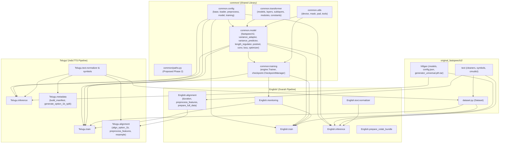

# FastSpeech 2 Project — Phase 1 Complete Read-Only Architecture Audit

**Project Root**: `/Users/swaruppal/FastSpeech2_Project`  
**Audit Date**: 2026-11-07  
**Phase Status**: **Phase 1 Completed (100% Read-Only — Zero existing files modified, moved, renamed, or deleted)**

---

## 1. Current Directory Structure & Inventory

The repository currently contains **133 Python modules** (outside `.venv/`, `data/`, and `preprocessed_data/`), **7 YAML configuration files**, **2 Colab notebooks**, **4 authoritative trained checkpoints**, **1 universal HiFi-GAN vocoder checkpoint**, **22 unit/integration test modules (`244` tests)**, and **62 verified assignment deliverables**.

```text
/Users/swaruppal/FastSpeech2_Project/
├── .gitignore                                # Git exclusion rules
├── README.md                                 # Project overview & reproduction instructions
├── requirements.txt                          # Verified Python 3.10 dependencies (22 packages)
├── SOURCE_ARCHIVE_MANIFEST.txt               # Protected historical archive listing
├── Telugu_IndicTTS_Features.tar.gz           # Protected Telugu feature archive (466.86 MiB)
├── English_FastSpeech2_Training.ipynb        # English Colab training notebook (19 cells)
├── Telugu_IndicTTS_Colab.ipynb               # Telugu Colab training notebook (25 cells)
│
├── common/                                   # Shared FastSpeech 2 core package (__init__.py: Yes)
│   ├── __init__.py
│   ├── audio/                                # Placeholder audio package (empty dir)
│   ├── config/                               # Validated YAML configuration schemas (__init__.py: Yes)
│   │   ├── __init__.py, base.py, loader.py, model.py, preprocess.py, training.py
│   ├── model/                                # Core FastSpeech 2 & Variance Adaptor (__init__.py: Yes)
│   │   ├── __init__.py, conv.py, fastspeech2.py, length_regulator.py, loss.py,
│   │   │   modules.py, optimizer.py, postnet.py, variance_adaptor.py, variance_predictor.py
│   ├── modules/                              # Backward-compatible re-export (__init__.py: Yes)
│   ├── training/                             # Trainer engine & CheckpointManager (__init__.py: Yes)
│   │   ├── __init__.py, checkpoint.py, engine.py
│   ├── transformer/                          # FFT Encoder/Decoder & Self-Attention (__init__.py: Yes)
│   │   ├── __init__.py, constants.py, layers.py, models.py, modules.py, sublayers.py
│   └── utils/                                # Device, masking, padding & tools (__init__.py: Yes)
│       ├── __init__.py, device.py, mask.py, pad.py, tools.py
│
├── English/                                  # English Svarah pipeline (__init__.py: Yes)
│   ├── __init__.py
│   ├── train.py                              # English training entry point
│   ├── inference.py                          # English inference & plotting CLI
│   ├── monitoring.py                         # Shared PersistentLogger, LiveDashboard & SystemMonitor
│   ├── prepare_colab_bundle.py               # English Colab bundle packager
│   ├── alignment/                            # MFA alignment & feature extraction (__init__.py: Yes)
│   │   ├── __init__.py, duration.py, prepare_full_data.py, prepare_pilot_data.py, preprocess_features.py
│   ├── metadata/                             # Svarah manifests & profile_stratified_v1 splits (__init__.py: NO)
│   │   └── generate_profile_stratified_v1_split.py (+ JSON/TXT/CSV manifests)
│   └── text/                                 # English text normalization (__init__.py: NO)
│       └── normalizer.py
│
├── Telugu/                                   # Telugu IndicTTS pipeline (__init__.py: NO)
│   ├── train.py                              # Telugu training entry point
│   ├── inference.py                          # Telugu inference & prosody plotting CLI
│   ├── alignment/                            # IndicTTS resampling, MFA Option 1B & features (__init__.py: NO)
│   │   └── align_option_1b.py, preprocess_features.py, resample.py, segmentation_pilot.py
│   ├── metadata/                             # IndicTTS manifests & split generators (__init__.py: NO)
│   │   └── build_manifest.py, generate_option_1b_split.py, partition_dataset.py (+ JSON/TXT/CSV)
│   └── text/                                 # Telugu NFC normalizer & 101-token symbols (__init__.py: NO)
│       └── normalizer.py, symbols.py, vocabulary.json
│
├── original_fastspeech2/                     # Reference implementation & HiFi-GAN (__init__.py: NO)
│   ├── dataset.py, evaluate.py, prepare_align.py, preprocess.py, synthesize.py, train.py
│   ├── audio/                                # (__init__.py: Yes)
│   ├── hifigan/                              # (__init__.py: Yes) + config.json + generator_universal.pth.tar
│   ├── lexicon/                              # librispeech-lexicon.txt
│   ├── model/                                # (__init__.py: Yes)
│   ├── preprocessor/                         # (__init__.py: NO)
│   ├── preprocessed_data/                    # Protected reference stats/speakers JSONs
│   ├── text/                                 # (__init__.py: Yes)
│   ├── transformer/                          # (__init__.py: Yes)
│   └── utils/                                # (__init__.py: NO)
│
├── config/                                   # Language YAML configurations
│   ├── Svarah/                               # preprocess.yaml, model.yaml, train.yaml, train_profile_stratified_v1.yaml
│   └── IndicTTS/                             # preprocess.yaml, model.yaml, train.yaml
│
├── checkpoints/                              # Authoritative trained checkpoints (Protected)
│   ├── Svarah_profile_stratified_v1/         # checkpoint_best.pth.tar (Step 19k), checkpoint_latest.pth.tar (Step 20k)
│   └── IndicTTS/                             # checkpoint_best.pth.tar (Step 13k), checkpoint_latest.pth.tar (Step 20k)
│
├── data/                                     # Raw audio corpora & MFA alignments (Protected, 7.32 GiB)
├── preprocessed_data/                        # Extracted .npy feature caches (Protected, 1.57 GiB)
│   ├── Svarah/                               # English features (15,488 .npy files + stats.json + speakers.json)
│   ├── IndicTTS/                             # Telugu features & stats.json / speakers.json
│   └── Telugu_Option_1B/                     # Telugu Option 1B features (2,721 utterances)
│
├── Results/                                  # Canonical assignment outputs (Protected)
│   ├── English/                              # test_generated_audios/, variance_adaptor_plots/, audio/, plots/, metadata/, loss PNGs
│   └── Telugu/                               # test_generated_audios/, variance_adaptor_plots/, Corrected_Assignment/, audio/, plots/, metadata/, official_samples.json, loss PNGs
│
├── output/                                   # Training/validation CSV histories & loss dashboards (Protected)
│   ├── logs/Svarah_profile_stratified_v1/    # English training_history.csv, validation_history.csv, plots/
│   └── log/IndicTTS/                         # Telugu training_history.csv, validation_history.csv, plots/
│
├── Report/                                   # Technical Report & Figures (Protected)
│   ├── Technical_Report.md, Technical_Report.pdf, figures/ (41 PNGs), tables/
│
├── documentation/                            # Architecture, manifest & cleanup reports
│   ├── English_Training_Evidence/            # Historical snapshot (includes duplicate implementation_snapshot/*.py)
│   ├── Telugu_Training_Evidence/             # Empty directory
│   └── *.md, *.json, dry_run_cleanup.py
│
├── research/                                 # 45 Markdown research reports + 11 pilot/audit .py scripts + 9 .json files
├── scratch/                                  # 4 build/report generation scripts (build_colab_notebook.py, build_manifest.py, compile_pdf.py, generate_technical_report.py)
└── tests/                                    # 22 unittest modules (244 tests) (__init__.py: NO)
```

---

## 2. Module Dependency Map



### Cross-Language & Cross-Package Coupling Notes
1. **`Telugu/train.py` imports `English.monitoring`**: `PersistentLogger`, `LiveDashboard`, `SystemMonitor`, `save_and_verify_checkpoint`, and `generate_training_summary` live in `English/monitoring.py` and are imported by both `English/train.py` and `Telugu/train.py`.
2. **`Telugu/alignment/preprocess_features.py` imports `English.alignment.duration`**: Reuses MFA TextGrid duration extraction utilities (`extract_utterance_durations`, `DurationExtractionResult`).
3. **`original_fastspeech2/dataset.py` imports `Telugu.text.normalizer`**: Dynamically branches on `self.language == "te"` to call `Telugu.text.normalizer.text_to_sequence`.
4. **Zero Circular Imports Currently Exist in `common/`**: `common.config`, `common.utils`, `common.transformer`, `common.model`, and `common.training` form a strict DAG. However, `common/paths.py` **must remain at the bottom of the DAG** (importing only Python standard library modules `os`, `sys`, `pathlib`, `typing`) so every layer (`common`, `English`, `Telugu`, `original_fastspeech2`, `tests`) can import `common.paths` with zero circularity risk.

---

## 3. Comprehensive Audit of Path & Import Vulnerabilities

### 3.1 Empirical CWD-Independence Failure Test (Running from `/tmp`)

We executed all 22 test modules with `cwd="/tmp"` and `PYTHONPATH="/Users/swaruppal/FastSpeech2_Project"`. **6 of the 22 test modules failed immediately (and 1 additional module silently skipped its assertions)** due to CWD-relative path dependencies:

| Failing / Skipping Module when `cwd=/tmp` | Root Cause File & Line | Exact Failure Mechanism |
| :--- | :--- | :--- |
| `tests/test_colab_monitoring_and_notebook.py` (4 errors) | [`common/model/fastspeech2.py`](../common/model/fastspeech2.py#L130-L137), [`original_fastspeech2/dataset.py`](../original_fastspeech2/dataset.py#L34-L94) | `preprocess.yaml` sets `preprocessed_path: "preprocessed_data/Svarah"`. Both `FastSpeech2.__init__` and `Dataset.__init__` open `os.path.join(preprocessed_path, "speakers.json")` and `"train.txt"` relative to `os.getcwd()` (`/tmp`) instead of resolving relative config paths against `PROJECT_ROOT`. |
| `tests/test_english_training_audit.py` (1 error) | [`common/model/fastspeech2.py`](../common/model/fastspeech2.py#L130-L137) | Same failure: `FastSpeech2(fs2_cfg.preprocess, fs2_cfg.model)` looks for `/tmp/preprocessed_data/Svarah/speakers.json`. |
| `tests/test_telugu_inference.py` (3 errors) | [`common/model/variance_adaptor.py`](../common/model/variance_adaptor.py#L88-L96) | `VarianceAdaptor.__init__` resolves `os.path.join(preprocess_config.path.preprocessed_path, "stats.json")` relative to `os.getcwd()` (`/tmp/preprocessed_data/IndicTTS/stats.json`). |
| `tests/test_duration_extraction.py` (1 failure) | [`tests/test_duration_extraction.py`](../tests/test_duration_extraction.py#L239) | Uses bare CWD-relative `glob.glob("data/svarah_pilot_100/textgrids/*/*.TextGrid")`, returning `0` files when `cwd != PROJECT_ROOT`. |
| `tests/test_fastspeech2_loss.py` (2 errors) | [`tests/test_fastspeech2_loss.py`](../tests/test_fastspeech2_loss.py#L590-L625) | Calls `spec_from_file_location("orig_loss", "original_fastspeech2/model/loss.py")` with a CWD-relative string, failing with `/private/tmp/original_fastspeech2/model/loss.py`. |
| `tests/test_telugu_mfa_alignment_pilot.py` (2 errors, 2 failures, 3 skips) | [`tests/test_telugu_mfa_alignment_pilot.py`](../tests/test_telugu_mfa_alignment_pilot.py#L20-L166) | Hardcodes CWD-relative strings `"research/Telugu_Dictionary_g2g.txt"`, `"data/telugu_mfa_pilot/output"`, `"Telugu/metadata/splits/option_1b/alignment"`, `"data/telugu_mfa_option_1b/TextGrid"`. |
| `tests/test_telugu_split_vocabulary_audit.py` (silent skip) | [`tests/test_telugu_split_vocabulary_audit.py`](../tests/test_telugu_split_vocabulary_audit.py#L34-L170) | Checks `if os.path.exists("research/...")` and `f"Telugu/metadata/{split}.txt"` relative to `os.getcwd()`, silently skipping tests when run outside `PROJECT_ROOT`. |

---

### 3.2 All Hardcoded Absolute Paths

| File | Line(s) | Hardcoded Path | Audit Assessment |
| :--- | :--- | :--- | :--- |
| [`documentation/dry_run_cleanup.py`](../documentation/dry_run_cleanup.py#L23-L24) | 23–24 | `Path("/Users/swaruppal/FastSpeech2_Project")`, `Path("/Users/swaruppal/Downloads/FastSpeech2_Cleanup_Backup")` | Replace with `get_project_root()` from `common/paths.py` |
| [`scratch/build_manifest.py`](../scratch/build_manifest.py#L13) | 13 | `PROJECT_ROOT = Path("/Users/swaruppal/FastSpeech2_Project")` | Replace with `get_project_root()` |
| [`scratch/compile_pdf.py`](../scratch/compile_pdf.py#L37-L38) | 37, 38, 376 | `Path("/Users/swaruppal/FastSpeech2_Project/Report/...")` | Replace with `get_project_root()` / `REPORT_DIR` |
| [`scratch/generate_technical_report.py`](../scratch/generate_technical_report.py#L22) | 22 | `Path("/Users/swaruppal/FastSpeech2_Project/Report/Technical_Report.md")` | Replace with `get_project_root()` / `REPORT_DIR` |
| [`English/inference.py`](../English/inference.py#L490-L491) | 490–491 | `Path("/content/drive/MyDrive/FastSpeech2_Project/checkpoints/...")` | Colab fallback search list (centralize in `common/paths.py`) |
| [`Telugu/inference.py`](../Telugu/inference.py#L608-L618) | 608–618, 1052–1053 | `Path("/content/drive/MyDrive/FastSpeech2_Telugu/...")` | Colab fallback search list (centralize in `common/paths.py`) |
| [`scratch/build_colab_notebook.py`](../scratch/build_colab_notebook.py#L112-L115) & [`research/build_colab_notebook.py`](../research/build_colab_notebook.py#L113) | 112–115 | `Path("/content/drive")`, `Path("/content/FastSpeech2_Project")` | Guarded Colab runtime paths inside notebook generator |

---

### 3.3 Relative Paths Depending on Current Working Directory (`os.getcwd()` / `./`)

1. **YAML Configuration Files (`config/Svarah/*.yaml`, `config/IndicTTS/*.yaml`)**:
   - `config/Svarah/preprocess.yaml`: `corpus_path: "data/svarah_train/corpus"`, `raw_path: "data/svarah_train/corpus"`, `preprocessed_path: "preprocessed_data/Svarah"`.
   - `config/Svarah/train.yaml`: `ckpt_path: "./output/ckpt/Svarah"`, `log_path: "./output/log/Svarah"`, `result_path: "./output/result/Svarah"`.
   - `config/Svarah/train_profile_stratified_v1.yaml`: `ckpt_path: "./output/ckpt/Svarah_profile_stratified_v1"`, `split_dir: "English/metadata/splits/profile_stratified_v1"`, `train_manifest: "English/metadata/splits/profile_stratified_v1/train.txt"`, `val_manifest: "English/metadata/splits/profile_stratified_v1/val.txt"`.
   - `config/IndicTTS/preprocess.yaml`: `corpus_path: "data/telugu_parquet/data"`, `raw_path: "data/telugu_parquet/data"`, `preprocessed_path: "preprocessed_data/IndicTTS"`.
   - `config/IndicTTS/train.yaml`: `ckpt_path: "./output/ckpt/IndicTTS"`, `log_path: "./output/log/IndicTTS"`, `result_path: "./output/result/IndicTTS"`, `train_manifest: "preprocessed_data/IndicTTS/train.txt"`, `val_manifest: "preprocessed_data/IndicTTS/val.txt"`.
2. **Core Model & Dataset Consumers of YAML Paths**:
   - [`common/model/fastspeech2.py`](../common/model/fastspeech2.py#L130-L139): Joins `preprocess_config.path.preprocessed_path` with `"speakers.json"` without resolving relative paths against `PROJECT_ROOT`.
   - [`common/model/variance_adaptor.py`](../common/model/variance_adaptor.py#L88-L96): Joins `preprocess_config.path.preprocessed_path` with `"stats.json"` without resolving relative paths against `PROJECT_ROOT`.
   - [`original_fastspeech2/dataset.py`](../original_fastspeech2/dataset.py#L26-L105): Uses `preprocess_config["path"]["preprocessed_path"]` directly as a relative string when opening `speakers.json`, `train.txt`/`val.txt`, and `mel`/`pitch`/`energy`/`duration` `.npy` files.
3. **Inference Checkpoint Resolution**:
   - [`English/inference.py`](../English/inference.py#L484) and [`Telugu/inference.py`](../Telugu/inference.py#L1043): `ckpt_base = Path(train_config.get("path", {}).get("ckpt_path", ...))` is checked as a CWD-relative path before falling back to `_PROJECT_ROOT`.
   - Furthermore, in [`Telugu/inference.py`](../Telugu/inference.py#L1046-L1055), look at `candidate_dirs`:
     - It checks `ckpt_base` (`./output/ckpt/IndicTTS`) and `_PROJECT_ROOT / "output" / "ckpt" / "IndicTTS"`, and `_PROJECT_ROOT / "checkpoints" / "IndicTTS"`. Centralizing checkpoint resolution in `common/paths.py` (`get_checkpoint_dir("te")`, `get_checkpoint_dir("en")`) makes this deterministic regardless of CWD.
4. **Research & Audit Scripts (`research/*.py`)**:
   - `research/audit_latin_o_corrections.py`, `research/build_mfa_pilot_selection.py`, `research/compute_exact_dataset_durations.py`, `research/download_telugu_parquet.py`, `research/inspect_alignment_quality.py`, `research/run_telugu_mfa_pilot.py`, `research/test_single_mfa_alignment.py`, `research/test_telugu_duration_extraction.py` all use bare CWD-relative paths (`"data/..."`, `"Telugu/metadata/..."`) and `sys.path.insert(0, os.path.abspath("."))`.

---

### 3.4 Missing `__init__.py` Files & Import Inconsistencies

1. **Missing `__init__.py` in Active Subpackages**:
   - `Telugu/__init__.py` — **MISSING** (Currently `Telugu` is a PEP 420 implicit namespace package, which breaks tools expecting standard Python packages with `__file__`).
   - `Telugu/text/__init__.py` — **MISSING**
   - `Telugu/alignment/__init__.py` — **MISSING**
   - `Telugu/metadata/__init__.py` — **MISSING**
   - `English/text/__init__.py` — **MISSING**
   - `English/metadata/__init__.py` — **MISSING**
   - `tests/__init__.py` — **MISSING**
   - `original_fastspeech2/__init__.py` — **MISSING**
   - `original_fastspeech2/utils/__init__.py` — **MISSING**
   - `original_fastspeech2/preprocessor/__init__.py` — **MISSING**
2. **Ad-hoc `Path(__file__).resolve().parent...` & `sys.path.insert` Proliferation**:
   - **21 separate files** independently compute `PROJECT_ROOT = Path(__file__).resolve().parent.parent` (or `.parents[2]`) and call `sys.path.insert(0, ...)`.
   - If any of those files is moved one directory level deeper or shallower, `.parent.parent` silently resolves to the wrong directory!
3. **Unprefixed `original_fastspeech2` Internal Imports**:
   - `English/train.py` and `Telugu/train.py` use `from dataset import Dataset` (relying on `original_fastspeech2` being injected into `sys.path`), whereas `tests/test_telugu_option1b_features.py` uses `from original_fastspeech2.dataset import Dataset`.
   - `English/monitoring.py` and `English/alignment/duration.py` use `from text.symbols import symbols` (relying on `original_fastspeech2` in `sys.path`), whereas `English/inference.py` uses `from original_fastspeech2.text import text_to_sequence`.
   - Note: `original_fastspeech2/dataset.py` and `original_fastspeech2/text/__init__.py` internally import `from text import ...` and `from utils.tools import ...`, so `original_fastspeech2` still needs to be accessible on `sys.path` when `original_fastspeech2` submodules run, **or** `common/paths.py` can provide a single idempotent `setup_project_paths()` helper that ensures both `PROJECT_ROOT` and `ORIGINAL_FS2_DIR` are cleanly registered on `sys.path`.

---

## 4. Duplicate Modules & Redundant Files Audit

| Duplicate / Overlapping Item | Locations | Comparison & Purpose | Recommendation |
| :--- | :--- | :--- | :--- |
| **Historical English Code Snapshot** | `documentation/English_Training_Evidence/implementation_snapshot/{__init__.py, train.py, inference.py, monitoring.py, text/normalizer.py}` vs `English/{__init__.py, train.py, inference.py, monitoring.py, text/normalizer.py}` | Byte-identical snapshot of `English/` saved as training audit evidence on 2026-11-05. Not imported by any code or test. | **Keep untouched** as historical training evidence (per strict safety rule on preserving training evidence), or exclude from Python module discovery. |
| **Colab Notebook Builder Scripts** | `research/build_colab_notebook.py` (English notebook builder) vs `scratch/build_colab_notebook.py` (Telugu notebook builder) | Despite identical filenames, `research/build_colab_notebook.py` generates `English_FastSpeech2_Training.ipynb` (and is imported/tested by `tests/test_colab_monitoring_and_notebook.py`!), whereas `scratch/build_colab_notebook.py` generates `Telugu_IndicTTS_Colab.ipynb`. | **Keep `research/build_colab_notebook.py` in place** (required by `test_colab_monitoring_and_notebook.py`). Update `scratch/build_colab_notebook.py` to use `common.paths`. |
| **Device Resolution Function** | `common/utils/device.py` (`get_device`), `common/training/engine.py` (`_resolve_device`), `English/inference.py` (`resolve_device`), `Telugu/inference.py` (`resolve_device`) | All 4 functions resolve `cuda` $\to$ `mps` $\to$ `cpu`. | Keep existing function signatures in place for backward compatibility with tests, delegating internally or preserving behavior. |
| **Empty Placeholder Directory** | `common/audio/` (empty directory), `documentation/Telugu_Training_Evidence/` (empty directory), `research/scratch_audio/` (empty directory), `output/ckpt/IndicTTS/` & `output/ckpt/Svarah/` (empty directories) | Empty directories left from earlier phases. | Can safely remove empty unused directories (`common/audio/`, `research/scratch_audio/`, `documentation/Telugu_Training_Evidence/`) or keep if desired. |
| **Duplicate English Metadata JSONs** | `Results/English/english_prosody_metadata.json` & `Results/English/english_samples_metadata.json` vs `Results/English/metadata/english_*.json` | Byte-identical copies (`122 KB` + `1.3 KB`). | **Keep untouched** (protected under `Results/English/`). |

---

## 5. Proposed Central Path Manager Design (`Phase 2: common/paths.py`)

We will create [`common/paths.py`](../common/paths.py) using **only Python standard library modules** (`os`, `sys`, `tempfile`, `pathlib.Path`, `typing`) with **zero ML/training/inference imports**.

### 5.1 Project Root Discovery Algorithm (`get_project_root()`)
Instead of fragile `.parent.parent` counting or `os.getcwd()`, `get_project_root()` resolves the project root deterministically:
1. **Environment Override (Colab / Custom Deployment)**: If `FASTSPEECH2_PROJECT_ROOT` is set in `os.environ` and points to a valid directory containing `common/` and `config/`, return `Path(os.environ["FASTSPEECH2_PROJECT_ROOT"]).resolve()`.
2. **Marker-Based Upward Traversal from `__file__`**: Starting from `Path(__file__).resolve().parent`, walk upward through `.parents` until finding the directory containing project sentinel markers (`common/`, `config/`, `English/`, `Telugu/`).
3. **Colab Runtime Fallback**: If running in `/content` on Google Colab where code was extracted to `/content/FastSpeech2_Project` or `/content/drive/MyDrive/FastSpeech2_Training/project`, detect and return that root.

### 5.2 Exported Path Constants & Functions in `common/paths.py`

- **Core Directory Constants (`pathlib.Path`)**:
  - `PROJECT_ROOT`: `/Users/swaruppal/FastSpeech2_Project` (dynamically discovered)
  - `COMMON_DIR`: `PROJECT_ROOT / "common"`
  - `ENGLISH_DIR`: `PROJECT_ROOT / "English"`
  - `TELUGU_DIR`: `PROJECT_ROOT / "Telugu"`
  - `ORIGINAL_FS2_DIR`: `PROJECT_ROOT / "original_fastspeech2"`
  - `CONFIG_DIR`: `PROJECT_ROOT / "config"`
  - `DATA_DIR`: `PROJECT_ROOT / "data"`
  - `PREPROCESSED_DIR`: `PROJECT_ROOT / "preprocessed_data"`
  - `CHECKPOINTS_DIR`: `PROJECT_ROOT / "checkpoints"`
  - `HIFIGAN_DIR`: `ORIGINAL_FS2_DIR / "hifigan"`
  - `HIFIGAN_CONFIG_PATH`: `HIFIGAN_DIR / "config.json"`
  - `HIFIGAN_WEIGHTS_PATH`: `HIFIGAN_DIR / "generator_universal.pth.tar"`
  - `LEXICON_PATH`: `ORIGINAL_FS2_DIR / "lexicon" / "librispeech-lexicon.txt"`
  - `RESULTS_DIR`: `PROJECT_ROOT / "Results"`
  - `OUTPUT_DIR`: `PROJECT_ROOT / "output"`
  - `REPORT_DIR`: `PROJECT_ROOT / "Report"`
  - `REPORT_FIGURES_DIR`: `REPORT_DIR / "figures"`
  - `DOCUMENTATION_DIR`: `PROJECT_ROOT / "documentation"`
  - `RESEARCH_DIR`: `PROJECT_ROOT / "research"`
  - `TESTS_DIR`: `PROJECT_ROOT / "tests"`
- **Required Functions**:
  - `get_project_root() -> Path`
  - `setup_project_paths() -> Path` (Idempotently ensures `str(PROJECT_ROOT)` and `str(ORIGINAL_FS2_DIR)` are on `sys.path`)
  - `resolve_project_path(path: str | Path) -> Path` (Resolves a relative path against `PROJECT_ROOT` if it does not exist relative to CWD, or always resolves project-relative config paths against `PROJECT_ROOT`)
  - `get_data_dir(language: str | None = None) -> Path` (`"en"` / `"english"` / `"svarah"` $\to$ `DATA_DIR / "svarah_train" / "corpus"`; `"te"` / `"telugu"` / `"indictts"` $\to$ `DATA_DIR / "telugu_parquet" / "data"`)
  - `get_preprocessed_dir(language: str, option: str | None = None) -> Path` (`"en"` $\to$ `PREPROCESSED_DIR / "Svarah"`; `"te"` $\to$ `PREPROCESSED_DIR / "IndicTTS"` or `PREPROCESSED_DIR / "Telugu_Option_1B"`)
  - `get_checkpoint_dir(language: str) -> Path` (`"en"` $\to$ `CHECKPOINTS_DIR / "Svarah_profile_stratified_v1"`; `"te"` $\to$ `CHECKPOINTS_DIR / "IndicTTS"`)
  - `get_best_checkpoint(language: str) -> Path` & `get_latest_checkpoint(language: str) -> Path`
  - `get_result_dir(language: str) -> Path` (`"en"` $\to$ `RESULTS_DIR / "English"`; `"te"` $\to$ `RESULTS_DIR / "Telugu"`)
  - `get_config_dir(language: str) -> Path` & `get_config_path(language: str, config_type: str = "preprocess") -> Path`
  - `ensure_output_dir(path: str | Path) -> Path` (Creates output directories safely when writing results/plots/logs)
  - `validate_required_path(path: str | Path, description: str = "Required path", must_be_dir: bool = False, must_be_file: bool = False) -> Path` (Raises a clear `FileNotFoundError` without ever creating missing dataset/checkpoint directories)
  - `get_temp_dir(prefix: str = "fastspeech2_") -> Path`

---

## 6. Canonical File Storage Mapping (`Phase 4 & Phase 5`)

### 6.1 Mapping of Existing Project Assets to Canonical Locations

| File Type | Canonical Location | Current Status in Workspace | Proposed Action |
| :--- | :--- | :--- | :--- |
| **Raw datasets** | `data/` | `data/` (`7.32 GiB`, 15,085 files) | **Untouched (Protected)** |
| **Preprocessed features** | `preprocessed_data/` | `preprocessed_data/{Svarah, IndicTTS, Telugu_Option_1B}` (`1.57 GiB`) | **Untouched (Protected)** |
| **Model checkpoints** | `checkpoints/` | `checkpoints/Svarah_profile_stratified_v1/` & `checkpoints/IndicTTS/` (`1.56 GiB`, 4 files) | **Untouched (Protected)** |
| **HiFi-GAN weights** | `original_fastspeech2/hifigan/` | `original_fastspeech2/hifigan/generator_universal.pth.tar` (`53.20 MiB`) | **Untouched (Protected)** |
| **Language configurations** | `config/` | `config/Svarah/` & `config/IndicTTS/` (7 YAML files) | **Keep in place** |
| **Training & inference source** | `English/` and `Telugu/` | `English/` and `Telugu/` | **Keep in place**; add missing `__init__.py` files and refactor path resolution to use `common/paths.py` |
| **Shared architecture & paths** | `common/` | `common/` | **Add `common/paths.py`**; update `fastspeech2.py` and `variance_adaptor.py` to resolve relative `preprocessed_path` via `common/paths.py` |
| **Generated audio & prosody plots** | `Results/English/` and `Results/Telugu/` | `Results/English/` & `Results/Telugu/` | **Untouched (Protected)** |
| **Report & report figures** | `Report/` and `Report/figures/` | `Report/Technical_Report.{md,pdf}`, `Report/figures/` (41 PNGs) | **Untouched (Protected)** |
| **Training histories & logs** | `output/` & `documentation/English_Training_Evidence/` | `output/logs/Svarah_profile_stratified_v1/` & `output/log/IndicTTS/` | **Untouched (Protected)** |
| **Tests** | `tests/` | `tests/test_*.py` (22 modules, 244 tests) | **Keep in place**; add `tests/__init__.py` and fix the 7 CWD-dependent test files to use `common.paths` |
| **Architecture documentation** | `documentation/` | `documentation/` | **Keep in place**; add `PROJECT_ARCHITECTURE_AUDIT.md`, `FINAL_PROJECT_STRUCTURE.md`, `PATH_DEPENDENCY_MAP.md`, `REFACTOR_CHANGELOG.md` |
| **Original reference implementation** | `original_fastspeech2/` | `original_fastspeech2/` | **Keep in place**; add `__init__.py` where needed and update `dataset.py` to resolve relative `preprocessed_path` via `common.paths` |

---

### 6.2 Files That Can Safely Be Relocated or Cleaned vs. Files That Must Remain Untouched

#### A. Candidate Relocations / Cleanups (For User Review)
1. **Report & Manifest Build Scripts Currently in `scratch/` (4 files)**:
   - `scratch/build_manifest.py`
   - `scratch/compile_pdf.py`
   - `scratch/generate_technical_report.py`
   - `scratch/build_colab_notebook.py`
   - *Issue*: Currently `scratch/` is ignored by `.gitignore` (`scratch/`), yet these 4 scripts are useful project maintenance utilities (`build_manifest.py` builds `documentation/final_artifact_manifest.json`; `compile_pdf.py` and `generate_technical_report.py` build `Report/Technical_Report.pdf`). Furthermore, 3 of them contain hardcoded `/Users/swaruppal/FastSpeech2_Project` paths.
   - *Option A (Recommended)*: Update all 4 scripts in `scratch/` to use `common.paths.get_project_root()` (removing all `/Users/swaruppal/FastSpeech2_Project` hardcoded strings) and **either** keep them in `scratch/` **or** copy/relocate `build_manifest.py` to `documentation/build_manifest.py` and `compile_pdf.py` / `generate_technical_report.py` to `Report/` (or keep them in `scratch/` if you prefer `scratch/` to remain untracked).
2. **Empty Placeholder Directories**:
   - `common/audio/` (0 files)
   - `documentation/Telugu_Training_Evidence/` (0 files)
   - `research/scratch_audio/` (0 files)
   - `output/ckpt/IndicTTS/` and `output/ckpt/Svarah/` (0 files; `output/ckpt/` is ignored by `.gitignore`)
   - *Recommendation*: Remove empty placeholder directories `common/audio/`, `documentation/Telugu_Training_Evidence/`, and `research/scratch_audio/`.
3. **Note on `research/build_colab_notebook.py` and `research/Telugu_Dictionary_g2g.txt`**:
   - [`tests/test_colab_monitoring_and_notebook.py`](../tests/test_colab_monitoring_and_notebook.py) explicitly asserts the existence of `research/build_colab_notebook.py` and `research/ENGLISH_COLAB_TRAINING_GUIDE.md`.
   - [`tests/test_telugu_mfa_alignment_pilot.py`](../tests/test_telugu_mfa_alignment_pilot.py) and [`tests/test_telugu_split_vocabulary_audit.py`](../tests/test_telugu_split_vocabulary_audit.py) explicitly read `research/Telugu_Dictionary_g2g.txt`, `research/telugu_mfa_pilot_results.json`, `research/telugu_duration_extraction_feasibility.json`, and `research/TELUGU_SPLIT_VOCABULARY_AUDIT.md`.
   - **Therefore, all files in `research/` must remain in `research/`** so zero existing test invariants are broken; we will only update the `.py` scripts in `research/` to resolve paths via `common.paths.get_project_root()` instead of CWD-relative strings.

#### B. Strictly Protected Files & Directories (MUST Remain Untouched)
- `data/` (all raw datasets, MFA pilot/full TextGrids, and acoustic models)
- `preprocessed_data/` (`Svarah/`, `IndicTTS/`, `Telugu_Option_1B/`)
- `original_fastspeech2/preprocessed_data/` (`LJSpeech/`, `LibriTTS/`, `AISHELL3/`)
- `checkpoints/Svarah_profile_stratified_v1/{checkpoint_best.pth.tar, checkpoint_latest.pth.tar}`
- `checkpoints/IndicTTS/{checkpoint_best.pth.tar, checkpoint_latest.pth.tar}`
- `original_fastspeech2/hifigan/{generator_universal.pth.tar, config.json, models.py}`
- `original_fastspeech2/lexicon/librispeech-lexicon.txt`
- `Results/English/` and `Results/Telugu/` (all WAV audio samples, variance adaptor plots, loss curves, and metadata JSONs)
- `Report/Technical_Report.md`, `Report/Technical_Report.pdf`, and `Report/figures/` (all 41 figures)
- `output/logs/Svarah_profile_stratified_v1/` and `output/log/IndicTTS/` (training/validation CSV histories, summaries, logs, and plots)
- `documentation/English_Training_Evidence/` (historical training evidence snapshot)
- `SOURCE_ARCHIVE_MANIFEST.txt` and `Telugu_IndicTTS_Features.tar.gz`
- `/Users/swaruppal/Downloads/FastSpeech2_Cleanup_Backup/` (external cleanup backup)

---

## 7. Proposed Step-by-Step Refactoring Plan (`Phases 2–8`)

1. **Phase 2 — Create `common/paths.py`**:
   - Implement marker-based `get_project_root()`, `setup_project_paths()`, `resolve_project_path()`, `get_data_dir()`, `get_preprocessed_dir()`, `get_checkpoint_dir()`, `get_result_dir()`, `get_config_path()`, `ensure_output_dir()`, and `validate_required_path()`.
   - Export path utilities cleanly in `common/__init__.py`.
2. **Phase 3 — Standardize Package Imports & `__init__.py` Files**:
   - Add `__init__.py` to `Telugu/`, `Telugu/text/`, `Telugu/alignment/`, `Telugu/metadata/`, `English/text/`, `English/metadata/`, `tests/`, `original_fastspeech2/`, `original_fastspeech2/utils/`, and `original_fastspeech2/preprocessor/`.
   - Replace repetitive `Path(__file__).resolve().parent...` + `sys.path.insert` boilerplate across `English/`, `Telugu/`, `tests/`, `research/`, `documentation/dry_run_cleanup.py`, and `scratch/` with `from common.paths import get_project_root, setup_project_paths, ...` (with a 3-line bootstrap fallback only in direct CLI entrypoints so `python English/inference.py` works even when invoked as a script file from `/tmp` without `PYTHONPATH`).
3. **Phase 4 & 5 — Fix All CWD-Relative Path Resolutions**:
   - **`common/model/fastspeech2.py` & `common/model/variance_adaptor.py`**: Resolve `preprocess_config.path.preprocessed_path` via `resolve_project_path()` when locating `speakers.json` and `stats.json` so `FastSpeech2(...)` and `VarianceAdaptor(...)` instantiate cleanly from any working directory.
   - **`original_fastspeech2/dataset.py`**: Resolve `self.preprocessed_path` and `filename` (`train.txt`, `val.txt`, or explicit manifest path) via `resolve_project_path()` so `Dataset(...)` works from any working directory while preserving Colab override paths.
   - **`English/inference.py` & `Telugu/inference.py` & `English/train.py` & `Telugu/train.py`**: Use `common/paths.py` for default config, checkpoint, vocoder, lexicon, preprocessed data, and output paths, and resolve any relative paths in loaded YAML configs against `get_project_root()`.
   - **`English/prepare_colab_bundle.py`**: Include `common/paths.py` and the new `__init__.py` files (`Telugu/__init__.py`, `English/text/__init__.py`, etc.) in the Colab bundle and handle Colab environments cleanly.
   - **Fix the 7 CWD-Dependent Test Modules**:
     - `tests/test_duration_extraction.py`
     - `tests/test_fastspeech2_loss.py`
     - `tests/test_telugu_mfa_alignment_pilot.py`
     - `tests/test_telugu_split_vocabulary_audit.py`
     - `tests/test_colab_monitoring_and_notebook.py`
     - `tests/test_english_training_audit.py`
     - `tests/test_telugu_inference.py`
     - Plus add a dedicated `tests/test_paths_and_cwd_independence.py` test module verifying `common/paths.py` and out-of-root execution.
4. **Phase 6 & 7 — Full Verification & Out-of-Tree Regression Testing**:
   - Verify all 244+ unit tests pass both from `/Users/swaruppal/FastSpeech2_Project` **and** when launched from `/tmp` outside the project root.
   - Verify importing every module, loading configs, loading English & Telugu best/latest checkpoints and HiFi-GAN weights, and running English & Telugu inference smoke tests into temporary directories from `/tmp`.
5. **Phase 8 — Final Documentation**:
   - Generate `documentation/FINAL_PROJECT_STRUCTURE.md`, `documentation/PATH_DEPENDENCY_MAP.md`, and `documentation/REFACTOR_CHANGELOG.md`, and refresh `documentation/final_artifact_manifest.json` and `documentation/FINAL_FILE_MANIFEST.json`.

