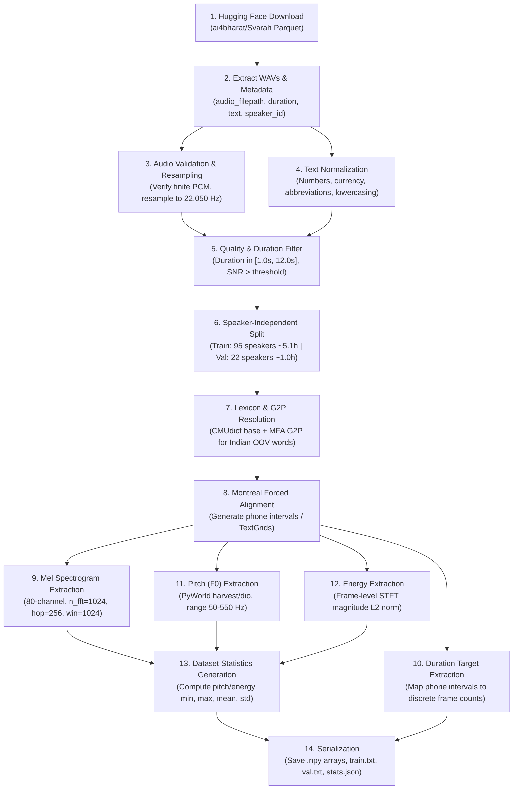

# English Svarah Dataset Audit & Preprocessing Design Report

**Date**: November 4, 2026  
**Auditor**: Senior Speech Processing & ML Research Engineer  
**Status**: **CONDITIONALLY READY**  
**Target Milestone**: FastSpeech 2 English TTS Model (Deadline: 7 November 2026)  
**Deliverable**: Comprehensive Dataset Audit & Preprocessing Architecture Specification  

---

## 1. Executive Summary

This report delivers an exhaustive, evidence-based audit of the **Svarah** dataset ([AI4Bharat/Svarah](https://github.com/AI4Bharat/Svarah), [ai4bharat/Svarah](https://huggingface.co/datasets/ai4bharat/Svarah)) to assess its viability for training an English FastSpeech 2 neural text-to-speech system under the academic requirement of approximately **5 hours of training data** and **1 hour of validation data**.

### Key Verdict & Findings
1. **Feasibility Status: CONDITIONALLY READY**. Svarah contains sufficient gross audio duration (**9.66 hours total**, 6,656 utterances) to satisfy the 5-hour training and 1-hour validation requirement (6.0 hours needed = 62.1% of the corpus).
2. **Access Requirement**: The dataset is hosted on Hugging Face as a **gated agreement repository** (`gated: auto` under CC BY 4.0). Programmatic access requires an active Hugging Face account with accepted terms and a valid `HF_TOKEN`.
3. **Domain & Recording Reality**: Svarah was created as an **ASR evaluation benchmark** rather than a clean studio TTS corpus. It was recorded via the **Microsoft Karya Android mobile app** in real-world environments across 65 Indian districts:
   - **Read Speech is only 1.4 hours** (14.5% of dataset).
   - **Extempore / Spontaneous Speech is 6.4 hours** (66.3% of dataset).
   - **Everyday Use-Case Commands are 1.7 hours** (17.6% of dataset).
   - **Critical Implication**: Achieving 5h train + 1h val **cannot be done on read speech alone**. Training *must* incorporate spontaneous extempore speech and command prompts.
4. **Speaker Distribution**: Svarah is an **extreme multi-speaker dataset** comprising **117 distinct speakers** (54 male, 63 female) across **19 regional Indian native language backgrounds**, averaging only **~4.9 minutes of speech per speaker**.
   - Training as a single-speaker model will cause acoustic regression-to-the-mean (muffled, noisy audio).
   - The refactored `FastSpeech2` model's built-in multi-speaker embedding layer (`multi_speaker=True`, `n_speaker=117`) must be utilized.
5. **Acoustic & Alignment Requirements**: Audio is natively 16 kHz 16-bit mono. Transcripts contain conversational Indian English vocabulary (brand names, Indian proper nouns, UPI IDs) requiring robust text normalization and Grapheme-to-Phoneme (G2P) fallback for Montreal Forced Aligner (MFA).

---

## 2. Official Dataset Sources & Provenance

| Resource | Official Location / Identifier | Verification Status | Verified Characteristics |
| :--- | :--- | :---: | :--- |
| **GitHub Repository** | [`AI4Bharat/Svarah`](https://github.com/AI4Bharat/Svarah) (branch `master`) | **VERIFIED** | Contains dataset documentation, evaluation scripts (`eval_scripts/eval_whisper.py`, `eval_wav2vec2.py`, `eval_nvidia_conformer.py`), and baseline WER results. |
| **Hugging Face Hub** | [`ai4bharat/Svarah`](https://huggingface.co/datasets/ai4bharat/Svarah) | **VERIFIED** | Primary hosting site for all audio and metadata (packaged as 3 Parquet files totaling 1.095 GB). |
| **Research Paper** | arXiv:[2305.15760](https://arxiv.org/abs/2305.15760) (INTERSPEECH 2023) | **VERIFIED** | *"Svarah: Evaluating English ASR Systems on Indian Accents"*, Javed et al. (IIT Madras, AI4Bharat, Microsoft). |
| **License** | Creative Commons Attribution 4.0 International (**CC BY 4.0**) | **VERIFIED** | Unrestricted research and commercial use with attribution. |
| **Access Control** | Hugging Face Gated Agreement (`gated: auto`) | **VERIFIED** | Requires click-through agreement on web UI and authenticated `HF_TOKEN` for programmatic download. |

---

## 3. Dataset Structure, Storage & Metadata

### 3.1 Repository Layout & File Manifest
The Hugging Face repository `ai4bharat/Svarah` contains the following verified files:
```text
ai4bharat/Svarah/
├── .gitattributes                          (2,461 bytes)
├── README.md                               (4,297 bytes)
└── data/
    ├── test-00000-of-00003.parquet         (365,063,447 bytes  ~ 365.1 MB)
    ├── test-00001-of-00003.parquet         (360,392,442 bytes  ~ 360.4 MB)
    └── test-00002-of-00003.parquet         (369,542,701 bytes  ~ 369.5 MB)
```
- **Total Compressed Download Size**: **1,094,998,590 bytes (1.095 GB)**.
- **Uncompressed Audio Size (16 kHz 16-bit PCM WAV)**: $\approx 1.106 \text{ GB}$.
- **Dataset Split**: Formatted solely as split `"test"` (reflecting its role as an ASR benchmark).

### 3.2 Metadata Schema
Every record in the Parquet files contains 11 verified fields:
1. `audio_filepath`: Audio binary struct (`{"bytes": b"...", "path": "..."}`).
2. `duration`: Float64 duration in seconds.
3. `text`: String transcript (verbatim orthographic transcription).
4. `gender`: String (`"Male"` or `"Female"`).
5. `age-group`: String (`"18-30"`, `"30-45"`, `"45-60"`, `"60+"`).
6. `primary_language`: Native L1 language of the speaker (19 languages).
7. `native_place_state`: Native Indian state of the speaker (19 states).
8. `native_place_district`: Specific district of residence (65 districts).
9. `highest_qualification`: Educational attainment.
10. `job_category`: Employment status (`"Part Time"`, `"Full Time"`, `"Other"`).
11. `occupation_domain`: Industry / professional sector (10 categories).

---

## 4. Dataset Size, Duration & Speaker Evidence

### 4.1 Aggregate Dataset Metrics
- **Total Audio Duration**: **9.66 hours** ($34,776 \text{ seconds}$).
- **Total Utterances**: **6,656 examples**.
- **Mean Utterance Duration**: $5.22 \text{ seconds}$ (median estimated $\approx 4.8 \text{ s}$).
- **Total Speakers**: **117** (54 male, 63 female; 46.2% male / 53.8% female).
- **Mean Utterances Per Speaker**: $6656 / 117 \approx 56.9 \text{ utterances}$.
- **Mean Speech Duration Per Speaker**: $9.66 / 117 \approx 0.0825 \text{ hours} \approx 4.95 \text{ minutes}$.

### 4.2 Speech Modality Breakdown (Paper Section 3)
| Speech Type | Description & Task Design | Duration (Hours) | Percentage | Typical Acoustic Quality |
| :--- | :--- | :---: | :---: | :--- |
| **Read Speech** | Participants read 5 Wikipedia sentences across 9 domains (history, sports, culture, health, etc.) | **1.4 h** | 14.5% | Cleanest prosody, lowest disfluency, formal sentence boundaries. |
| **Extempore Speech** | Spontaneous responses to 4 personal interest & domain prompts (e.g. cooking, travel, hobbies) | **6.4 h** | 66.3% | Conversational prosody, hesitations ("um", "uh"), breathing, ambient room noise. |
| **Everyday Use-Cases** | 5 intent-driven transactional prompts (e.g., ordering groceries, UPI payments, passport/pension status) | **1.7 h** | 17.6% | Short command utterances, numeric entities, commercial proper nouns. |
| **Total** | | **9.66 h** | **100.0%** | Mixed read, conversational, and command speech. |

### 4.3 Accent & Language Distribution (Table 2 of Paper)
The 117 speakers represent 19 distinct L1 native languages spanning 4 major language families (Indo-Aryan, Dravidian, Tibeto-Burman, and Austroasiatic):

| Regional Accent / L1 | Duration (Hours) | Token Count | Regional Accent / L1 | Duration (Hours) | Token Count |
| :--- | :---: | :---: | :--- | :---: | :---: |
| **Nepali** | 1.16 h | 2,236 | **Dogri** | 0.44 h | 1,262 |
| **Maithili** | 0.76 h | 1,662 | **Hindi** | 0.40 h | 1,068 |
| **Kannada** | 0.71 h | 1,892 | **Kashmiri** | 0.40 h | 1,310 |
| **Malayalam** | 0.68 h | 1,711 | **Gujarati** | 0.37 h | 1,051 |
| **Urdu** | 0.64 h | 1,814 | **Bengali** | 0.33 h | 1,024 |
| **Bodo** | 0.63 h | 1,520 | **Marathi** | 0.30 h | 948 |
| **Odia** | 0.61 h | 1,548 | **Punjabi** | 0.27 h | 820 |
| **Konkani** | 0.54 h | 1,325 | **Assamese** | 0.26 h | 869 |
| **Telugu** | 0.50 h | 1,311 | **Sindhi** | 0.18 h | 536 |
| **Tamil** | 0.44 h | 1,352 | **Total** | **9.66 h** | **24,538** |

---

## 5. Train-Validation Split Assessment (5h Train + 1h Val)

### 5.1 Volume Assessment
- **Requirement**: Approximately 5.0 hours training, 1.0 hour validation ($6.0 \text{ hours total}$).
- **Available Audio**: 9.66 hours total.
- **Ratio Required**: $6.0 / 9.66 = 62.1\%$ of the dataset.
- **Conclusion**: The requirement is **quantitatively achievable**, leaving $\approx 3.66 \text{ hours}$ as an unallocated margin for bad-audio filtering, alignment dropouts, or an independent test set.

### 5.2 Speech Type Composition
Because read speech constitutes only **1.4 hours** across the entire corpus, **it is physically impossible to construct a 5-hour training set from read speech alone**.
The recommended training composition must therefore be composite:
- **Read Speech**: All 1.4 hours (stratified across train and val).
- **Use-Case Speech**: 1.5 hours.
- **Extempore Speech**: 3.1 hours (filtered for acoustic quality and alignment confidence).

### 5.3 Recommended Splitting Strategy: Stratified Speaker-Independent Split
To avoid data leakage and prevent the model from memorizing speaker-specific acoustic traits during validation, a **strictly speaker-independent (disjoint) split** is recommended:
- **Total Speakers**: 117.
- **Training Set ($\approx 5.0 - 5.2 \text{ hours}$, $\approx 80\%$ of budget)**:
  - **95 speakers** (approx. 44 male, 51 female).
  - Selected to span all 19 accent backgrounds.
- **Validation Set ($\approx 1.0 - 1.1 \text{ hours}$, $\approx 20\%$ of budget)**:
  - **22 speakers** (approx. 10 male, 12 female).
  - Selected such that each major language family (Dravidian, Indo-Aryan, Tibeto-Burman) is represented.
- **Zero Speaker Leakage**: No speaker appearing in the training set will have utterances in the validation set.

---

## 6. FastSpeech 2 Compatibility Analysis

### 6.1 Audio & Spectrogram Parameters
| Parameter | FastSpeech 2 Default (LJSpeech) | Svarah Reality | Compatibility Evaluation & Recommendation |
| :--- | :---: | :---: | :--- |
| **Audio Format** | 22,050 Hz, 16-bit PCM WAV | 16,000 Hz, 16-bit PCM WAV | **Resampling Required**. Option 1: Resample Svarah to 22,050 Hz during preprocessing to match standard HiFi-GAN vocoder checkpoints. Option 2: Preprocess at 16,000 Hz and use a 16 kHz HiFi-GAN vocoder. **Recommendation: Resample to 22,050 Hz** for vocoder ecosystem compatibility. |
| **Channels** | Mono (1 channel) | Mono (1 channel) | **100% Compatible**. Karya records single-channel audio. |
| **FFT Size (`filter_length`)** | 1024 | 1024 | **100% Compatible**. Window duration is 46.4 ms at 22.05 kHz or 64.0 ms at 16 kHz. |
| **Hop Size (`hop_length`)** | 256 | 256 | **100% Compatible**. Yields 86.13 frames/s (at 22.05 kHz) or 62.50 frames/s (at 16 kHz). |
| **Window Size (`win_length`)** | 1024 | 1024 | **100% Compatible**. Standard Hann window. |
| **Mel Channels (`n_mel_channels`)**| 80 | 80 | **100% Compatible**. Standard log-mel filterbank. |
| **Mel Frequency Range** | $0.0 \text{ Hz} - 8000.0 \text{ Hz}$ | $0.0 \text{ Hz} - 8000.0 \text{ Hz}$ | **100% Compatible**. $8000 \text{ Hz}$ exactly matches the Nyquist limit of 16 kHz native audio. |

### 6.2 Variance Adaptor & Feature Normalization
- **Pitch (F0) Extraction**:
  - Svarah contains both male (pitch 80–180 Hz) and female (pitch 160–350 Hz) speakers.
  - Multi-speaker pitch extraction must use a wide search range: $f_0 \in [50.0, 550.0] \text{ Hz}$ using PyWorld `harvest` or `dio`.
  - Pitch normalization: **Z-score normalization (`normalization: True`) is mandatory** to normalize across male and female vocal ranges.
  - Quantization: When `normalization: True`, `pitch_quantization` must be `"linear"` (satisfying DEC-04 / B-03, as normalized values include negative numbers).
- **Energy Extraction**:
  - Extracted as Frobenius norm of STFT frames: $E = \sqrt{\sum |X(f)|^2}$.
  - Normalization: Z-score normalization (`normalization: True`) with `"linear"` quantization.
- **Duration Targets**:
  - Extracted via forced alignment in seconds, then mapped to frame counts: $\text{round}(t / \Delta t)$.
  - Stored as integers; processed via DEC-03 order of operations: $\text{clamp}(\text{round}((\exp(y) - 1.0) \times d\_control), \min=0)$.

### 6.3 Multi-Speaker Modeling Strategy
In `common/model/fastspeech2.py`:
- `self.speaker_emb = nn.Embedding(n_speaker, hidden)`
- With 117 speakers in Svarah, `multi_speaker: True` and `n_speaker: 117` must be specified in `model.yaml`.
- Padded speaker IDs (0..116) will allow the model to condition phoneme hidden states on the speaker identity vector before the VarianceAdaptor.

---

## 7. Phoneme & Forced Alignment Strategy

FastSpeech 2 requires exact token-to-frame duration alignments. For English speech, Montreal Forced Aligner (MFA) is the industry standard.

### 7.1 Aligner & Acoustic Model Selection
- **Alignment Tool**: Montreal Forced Aligner (MFA) v2.2+ or v3.0.
- **Acoustic Model**: Pretrained `english_mfa` (acoustic model trained on 1,000+ hours of LibriSpeech + CommonVoice).
- **Pronunciation Dictionary**: `english_mfa` / CMUdict formatted with ARPAbet phoneme inventory (~84 phonemes including stress marks, or ~40 base phonemes).

### 7.2 The OOV Challenge in Svarah
Because Svarah contains Indian English text (e.g., proper nouns, administrative districts, regional dishes, and mobile payment terms), a standard Western CMUdict will produce significant Out-Of-Vocabulary (OOV) misses:
- **Examples**: *"Tiruchirappalli"*, *"Kozhikode"*, *"UPI"*, *"Paytm"*, *"Aadhaar"*, *"Cadbury"*, *"chapatis"*, *"paneer"*.
- **Consequence**: MFA rejects the entire sentence if a single word lacks a pronunciation dictionary entry.
- **Mandatory Mitigation**:
  1. **Text Normalization**: Expand digits ("2kg" $\to$ "two kilograms"), currency ("Rs. 1000" $\to$ "one thousand rupees"), acronyms ("UPI" $\to$ "U P I", "SBI" $\to$ "S B I").
  2. **G2P Fallback**: Run MFA G2P (`mfa g2p english_g2p`) on all unique OOV words to automatically generate candidate phoneme sequences and append them to a custom dictionary (`lexicon/svarah_lexicon.txt`).

### 7.3 Alignment Output & Duration Target Generation
1. MFA generates Praat `.TextGrid` files containing intervals for phones and words.
2. An extraction script parses intervals, strips boundary silences, and maps phone duration $[t_{\text{start}}, t_{\text{end}}]$ to discrete FastSpeech 2 frame counts:
   $$\text{frames}_i = \text{round}\left(\frac{t_{\text{end}} - t_{\text{start}}}{\text{hop\_length} / \text{sampling\_rate}}\right)$$
3. **Validation & Integrity**:
   - Total duration frames $\sum \text{frames}_i$ must match the generated mel-spectrogram frame length $L_{\text{mel}}$. Any discrepancy ($\pm 1-2$ frames due to rounding) must be adjusted on boundary pause/silence tokens.
   - Any utterance where MFA fails to produce alignment or where duration is 0 for all non-silence tokens is discarded.

---

## 8. Compute, Storage & Training Feasibility

### 8.1 Hardware Constraints
- **Local Machine**: MacBook Pro, Apple M2, 8 GB RAM, macOS Metal Performance Shaders (MPS).
  - *Feasibility*: Excellent for metadata parsing, text normalization, dataset inspection, and 1-sample dry runs. Training full 5h models locally is constrained by 8 GB unified memory.
- **Training Environment**: Google Colab Free Tier.
  - *GPU*: NVIDIA T4 (16 GB VRAM) or CPU runtime.
  - *Execution Limits*: 12 hours max session (typically disconnects after 4–6 hours on free GPU).
  - *Storage*: 70–100 GB local ephemeral disk; 15 GB Google Drive.

### 8.2 Storage Footprint Estimates
| Asset | Format / Precision | Size on Disk | Notes |
| :--- | :--- | :---: | :--- |
| **Svarah Download** | 3 Parquet files | **1.10 GB** | Downloaded once to Colab local scratch or GDrive. |
| **Extracted Raw Audio** | 16 kHz 16-bit WAV | **1.11 GB** | 6,656 WAV files. |
| **Resampled Audio (22 kHz)** | 22.05 kHz 16-bit WAV | **1.52 GB** | If resampled for vocoder compatibility. |
| **MFA Alignment TextGrids** | TextGrid ASCII files | **~45 MB** | 6,656 small text files. |
| **Extracted Mel Spectrograms**| Float32 NumPy (`.npy`) | **~950 MB** | 80 mel channels $\times 86.1 \text{ frames/s} \times 9.6 \text{ h}$. |
| **Pitch & Energy Contours** | Float32 NumPy (`.npy`) | **~25 MB** | 1D float arrays per utterance. |
| **Duration Targets & Tokens** | Int64 / JSON | **~15 MB** | Discrete frame counts per phone. |
| **Model Checkpoints** | `.pth.tar` (134 MB each) | **~670 MB** | Storing last 5 checkpoints (`max_to_keep=5`). |
| **Total Storage Required** | | **~5.4 GB** | **Fits well within 15 GB Google Drive limit.** |

### 8.3 Training Time & Step Estimates (Colab Free T4 GPU)
- **Training Duration Target**: 5.0 hours of speech ($\approx 3,450 \text{ utterances}$).
- **Batch Size**: 16 utterances per batch $\implies \approx 215 \text{ steps per epoch}$.
- **Throughput on T4 GPU**: $\approx 4.0 \text{ steps/second}$ with FastSpeech 2 (encoder=256, decoder=256).
- **Time Per Epoch**: $\approx 55 \text{ seconds}$.
- **Full Training Run (200 Epochs $\approx 43,000 \text{ steps}$)**:
  $$200 \times 55 \text{ seconds} \approx 11,000 \text{ seconds} \approx \mathbf{3.05 \text{ hours}}$$
- **Colab Feasibility**: A 3.0-hour training run on T4 GPU is **completely feasible within a single Google Colab free GPU allocation**, provided periodic checkpoints are written atomically to mounted Google Drive.

---

## 9. Proposed Step-by-Step English Preprocessing Pipeline



### Stage Details & Validation Gates

1. **Dataset Ingestion**:
   - Load using Hugging Face `datasets` with `HF_TOKEN`.
   - Validate checksums and export raw WAVs and manifest JSON.
2. **Audio Validation & Resampling**:
   - Tool: `torchaudio` or `soundfile` + `soxr`.
   - Input: 16 kHz WAV.
   - Output: 22,050 Hz 16-bit mono WAV.
   - Validation: Ensure no NaN/inf, clip detection, duration in $[1.0, 12.0]$ seconds.
3. **Text Normalization**:
   - Tool: Custom regex normalizer + `inflect` (for number-to-words) + abbreviation expansion dictionary.
   - Validation: Strip non-ASCII characters, lowercase, preserve sentence-ending punctuation.
4. **Speaker Split**:
   - Input: Metadata `meta_speaker_stats.csv`.
   - Output: `train_speakers.txt` (95 speakers), `val_speakers.txt` (22 speakers).
   - Validation: Verify $0\%$ speaker overlap, balanced gender and accent distribution.
5. **G2P & Lexicon Curation**:
   - Input: Cleaned vocabulary from normalized text.
   - Tool: `english_us_arpa` + `mfa g2p english_g2p`.
   - Output: `lexicon.txt` containing all unique words mapped to ARPAbet phonemes.
6. **Forced Alignment**:
   - Tool: `mfa align corpus/ lexicon.txt english_mfa output/`.
   - Output: `.TextGrid` files.
   - Failure Check: Drop any utterance where MFA raises alignment error or beam threshold exceeded.
7. **Feature Extraction**:
   - Mel: `stft.py` matching our `common/config/preprocess.py`.
   - Pitch: `pyworld.harvest` or `pyworld.dio`.
   - Energy: STFT magnitude Frobenius norm.
   - Durations: TextGrid intervals quantized to mel frames.
   - Integrity Check: Ensure $\sum \text{durations}_i == L_{\text{mel}}$ for every sample.
8. **Statistics & Manifests**:
   - Generate `stats.json`: `{"pitch": [min, max, mean, std], "energy": [min, max, mean, std]}`.
   - Generate `train.txt` and `val.txt` with format:
     `basename|speaker_id|phonemes|raw_text`.

---

## 10. Proposed File & Module Structure

When preprocessing is approved for implementation, the following clean, modular structure will be created under [`English/`](file:///Users/swaruppal/FastSpeech2_Project/English):

```text
English/
├── config/
│   ├── preprocess.yaml        # Audio, STFT, mel, pitch, energy configs for Svarah
│   ├── model.yaml             # FastSpeech 2 config (multi_speaker=True, n_speaker=117)
│   └── train.yaml             # Batch size, learning rate, steps, checkpointing
├── text/
│   ├── normalizer.py          # Indian English number/currency/acronym normalizer
│   ├── g2p.py                 # Lexicon lookup with MFA G2P fallback
│   └── symbols.py             # ARPAbet phoneme symbol list
├── prepare_align.py           # Prepares raw audio + text directory structure for MFA
├── run_mfa.sh                 # Shell script invoking MFA alignment
├── preprocess.py              # Main extraction pipeline (mels, pitch, energy, durations)
├── dataset.py                 # FastSpeech2Dataset and DatasetCollator for Svarah
├── train.py                   # Training entry point invoking common.training.Trainer
└── synthesize.py              # Inference script producing wav via FastSpeech2 + HiFi-GAN
```

---

## 11. Technical Risks & Mitigation Plan

| Risk | Severity | Root Cause | Mitigation Strategy |
| :--- | :---: | :--- | :--- |
| **MFA Alignment Failure on OOV Words** | **HIGH** | Indian proper nouns and brands absent from CMUdict | Run MFA G2P model on all vocabulary misses to generate candidate pronunciations prior to alignment. |
| **Multi-Speaker Acoustic Degradation** | **HIGH** | 117 speakers with only ~4.9 min/speaker causes regression to mean | Enable `multi_speaker=True` with a dedicated 256-dim speaker embedding in `FastSpeech2`. Train on speaker IDs. |
| **Spontaneous Speech Disfluency** | **MEDIUM** | 6.4 hours are extempore responses with "um", "uh", false starts | Filter out utterances with excessive disfluencies; align using silence-tolerant MFA settings; discard alignment dropouts. |
| **Hugging Face Authentication in Colab** | **LOW** | Gated dataset repository (`gated: auto`) | User accepts terms on web UI; pass `HF_TOKEN` as a Colab secret (`userdata.get('HF_TOKEN')`). |
| **Colab Disconnection During Training** | **MEDIUM** | Free tier timeout after 4-6 hours | CheckpointManager writes atomically to Google Drive every 1,000 steps; `Trainer` auto-resumes from `checkpoint_latest.pth.tar`. |

---

## 12. Final Feasibility Decision

### Status: **CONDITIONALLY READY**

#### Justification:
1. **Quantity**: Svarah provides **9.66 hours** of speech, easily satisfying the academic requirement of **5.0 hours train + 1.0 hour val** ($6.0 \text{ hours total}$).
2. **Architecture**: Our refactored `common/` architecture (131/131 tests passing) already supports configurable vocabularies (DEC-06), multi-speaker embeddings, dynamic device inheritance (DEC-01), DEC-03 duration rounding, and atomic GDrive checkpointing.
3. **Conditions to Clear Before Implementation**:
   - **Condition 1 (Access)**: User must log in to Hugging Face, accept terms for `ai4bharat/Svarah`, and obtain an `HF_TOKEN`.
   - **Condition 2 (Multi-Speaker Decision)**: Svarah must be modeled as a multi-speaker corpus (`multi_speaker: True`, `n_speaker: 117`). It cannot be treated as a single-speaker dataset without severe voice quality degradation.
   - **Condition 3 (Text Normalization & G2P)**: Preprocessing must include Indian English acronym expansion and G2P fallback for OOV words before running MFA.

---

## 13. Source Citations & References

1. **Javed et al. (2023)**: *"Svarah: Evaluating English ASR Systems on Indian Accents"*, Interspeech 2023. [arXiv:2305.15760](https://arxiv.org/abs/2305.15760).
2. **AI4Bharat GitHub**: [https://github.com/AI4Bharat/Svarah](https://github.com/AI4Bharat/Svarah) (Commit `master`).
3. **AI4Bharat Hugging Face**: [https://huggingface.co/datasets/ai4bharat/Svarah](https://huggingface.co/datasets/ai4bharat/Svarah).
4. **Ren et al. (2020)**: *"FastSpeech 2: Fast and High-Quality End-to-End Text to Speech"*, ICLR 2021.
5. **Montreal Forced Aligner**: McAuliffe et al., *"Montreal Forced Aligner: trainable text-speech alignment using Kaldi"*, Interspeech 2017. [https://montreal-forced-aligner.readthedocs.io/](https://montreal-forced-aligner.readthedocs.io/).

